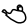
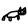
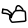
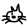
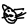
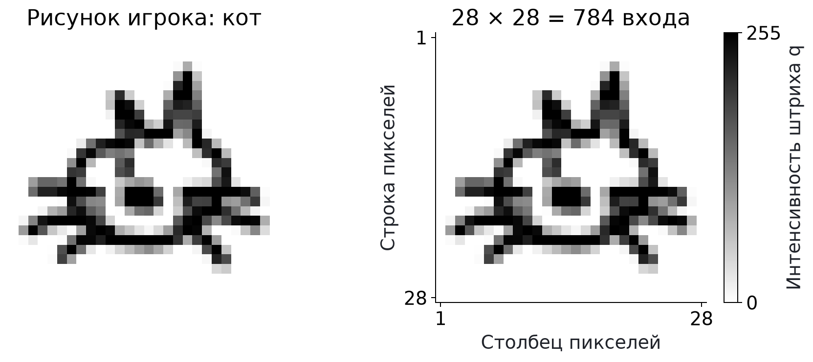
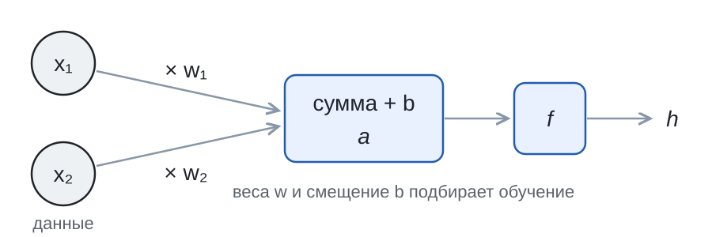
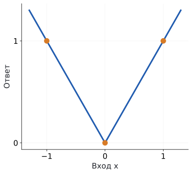
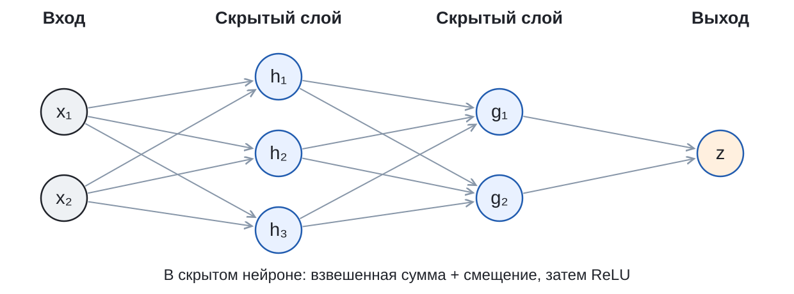

## Что здесь нарисовано? {#l3-02}

Рисунок 1 из 6

Что нарисовал участник?

<button type="button" data-guess="Кот" aria-pressed="false">Кот</button>
<button type="button" data-guess="Чайник" aria-pressed="false">Чайник</button>

Выберите вариант, чтобы открыть метку набора.

<button type="button" data-next hidden>Следующий рисунок</button>

[Подборка: 6 рисунков Google Quick, Draw!, по 3 из категорий cat и teapot. Google и участники проекта, CC BY 4.0.]{.source}

## Правило «если усы, то кот» {#l3-03}

::: {.columns}
::: {.column width="50%"}
{height=230 fig-alt="Кот с ушами и усами"}
[Рисунок 4: кот с усами]{.caption}
:::
::: {.column width="50%"}
{height=230 fig-alt="Кот без усов и глаз"}
[Рисунок 2: тоже кот]{.caption}
:::
:::

Правила вручную быстро обрастают исключениями. Пусть программа **сама подберёт правило по примерам**.

[Опр.]{.definition} **Нейронная сеть**: модель из простых вычислительных элементов, соединённых в цепочки; их числа подбираются обучением на примерах.

[Рисунки Google Quick, Draw!, CC BY 4.0]{.source}

## Рисунок превращается в числа {#l3-04}

{height=320 fig-alt="Рисунок QuickDraw и сетка пикселей"}

Формат QuickDraw: **28 × 28** пикселей, $28\cdot28=784$ числа на рисунок.

В файле яркость штриха $q$ от **0** (фон) до **255** (самый плотный штрих). Делим: $x=q/255$, получаем числа от 0 до 1.

[Google Quick, Draw!, CC BY 4.0. Деление на 255 выбрано нами]{.source}

## Что должна ответить сеть {#l3-05}

[Опр.]{.definition} **Классификация**: выбор категории для объекта.

Договоримся о кодах меток: $y=0$ **кот**, $y=1$ **чайник**.

Сеть выдаёт одно число $p$ от 0 до 1: **оценку того, что на рисунке чайник**. Тогда оценка кота $1-p$.

| $p$ | 0.03 | 0.5 | 0.97 |
|---|:-:|:-:|:-:|
| Как читать | почти точно кот | не знаю | почти точно чайник |

[Значения $p$ в таблице условные, для чтения шкалы]{.given}

## Один нейрон {#l3-06}

{height=210 fig-alt="Входы x1 и x2 умножаются на веса w1 и w2, складываются со смещением b в сумму a, функция f даёт h"}

[Опр.]{.definition} **Нейрон**: взвешенная сумма входов плюс смещение, к которой применяют функцию активации.
$$a=w_1x_1+w_2x_2+b,\qquad h=f(a).$$

**Входы** $x$ приходят из данных. **Веса** $w$ и **смещение** $b$ подбирает обучение.

## Две прямые дают прямую {#l3-07}

**Поставим два нейрона подряд без функции активации.** Поможет?

Для проверки выберем два правила:
$$h=2x+1,\qquad z=3h-4.$$

::: {.fragment}
Подставляем $h$:
$$z=3(2x+1)-4=6x+3-4=6x-1.$$

Снова одна прямая. Сколько ни ставь линейных слоёв подряд, получится **одна линейная формула**. Между слоями нужна **нелинейная** функция.
:::

[Коэффициенты 2, 1, 3, −4 выбраны для проверки]{.given}

## ReLU: функция с изломом {#l3-08}

[Опр.]{.definition} **ReLU**: функция активации $\operatorname{ReLU}(a)=\max(0,a)$. Отрицательное превращает в ноль, положительное оставляет.

<svg viewBox="0 0 440 290" role="img" aria-label="График h = max(0, w·x + b)">
<line x1="40" y1="250" x2="400" y2="250" class="axis"/>
<line x1="220" y1="20" x2="220" y2="260" class="axis"/>
<text x="404" y="255">x</text><text x="226" y="30">h</text>
<text x="40" y="275">−4</text><text x="214" y="275">0</text><text x="392" y="275">4</text>
<text x="196" y="155">2</text><line x1="215" y1="150" x2="225" y2="150" class="axis"/>
<polyline fill="none" class="relu-line"/>
<circle r="7" class="relu-kink"/>
</svg>

h = max(0, w·x + b)

<label>вес w <input type="range" name="w" min="-2" max="2" step="0.5" value="1"></label>
<label>смещение b <input type="range" name="b" min="-3" max="3" step="0.5" value="0"></label>

[Ползунки: вес $w$ от −2 до 2, смещение $b$ от −3 до 3, шаг 0.5. Нейрон с одним входом: $h=\max(0,\ w\cdot x+b)$]{.given}

## Два нейрона рисуют галочку {#l3-09}

::: {.columns}
::: {.column width="55%"}
{height=400 fig-alt="Пары минус один и один, ноль и ноль, один и один; два ReLU дают V-образную линию через эти точки"}
:::
::: {.column width="45%"}
Учебные пары: $(-1,\,1)$, $(0,\,0)$, $(1,\,1)$.

**Одна прямая через все три?**

::: {.fragment}
Два нейрона, веса $1$ и $-1$, смещения $0$:
$$h_1=\operatorname{ReLU}(x),\quad h_2=\operatorname{ReLU}(-x),$$
$$\widehat y=h_1+h_2=|x|.$$
:::
:::
:::

[Пары и все веса заданы вручную для проверки]{.given}

## Сеть целиком {#l3-10}

{height=290 fig-alt="Входы x1, x2; скрытый слой из трёх нейронов; следующий скрытый слой из двух; один выход z"}

[Опр.]{.definition} **Полносвязная сеть**: каждый нейрон получает все значения предыдущего слоя; считаем слева направо.

[Опр.]{.definition} **Скрытый слой**: нейроны между входом и выходом. **Ширина**: нейронов в слое. **Глубина**: число скрытых слоёв.

[Схема выбрана для примера: 2 входа → 3 → 2 → 1 выход, ширины 3 и 2, глубина 2]{.given}

## Рентген обученной сети {#l3-11}

<canvas class="xray-pad" width="240" height="240" aria-label="Поле для рисунка мышью"></canvas>

<button type="button" data-clear>Стереть</button> <button type="button" data-sample="0">кот</button> <button type="button" data-sample="1">чайник</button> <button type="button" data-sample="2">ошибка сети</button> <button type="button" data-sample="3">кролик</button>

Вход
<canvas class="xray-input" width="28" height="28" aria-label="Что получает сеть: 28 на 28"></canvas>
28 × 28

16 скрытых нейронов: голос + за чайник, − за кота

<canvas width="28" height="28" aria-label="Веса нейрона 1"></canvas>

<canvas width="28" height="28" aria-label="Веса нейрона 2"></canvas>

<canvas width="28" height="28" aria-label="Веса нейрона 3"></canvas>

<canvas width="28" height="28" aria-label="Веса нейрона 4"></canvas>

<canvas width="28" height="28" aria-label="Веса нейрона 5"></canvas>

<canvas width="28" height="28" aria-label="Веса нейрона 6"></canvas>

<canvas width="28" height="28" aria-label="Веса нейрона 7"></canvas>

<canvas width="28" height="28" aria-label="Веса нейрона 8"></canvas>

<canvas width="28" height="28" aria-label="Веса нейрона 9"></canvas>

<canvas width="28" height="28" aria-label="Веса нейрона 10"></canvas>

<canvas width="28" height="28" aria-label="Веса нейрона 11"></canvas>

<canvas width="28" height="28" aria-label="Веса нейрона 12"></canvas>

<canvas width="28" height="28" aria-label="Веса нейрона 13"></canvas>

<canvas width="28" height="28" aria-label="Веса нейрона 14"></canvas>

<canvas width="28" height="28" aria-label="Веса нейрона 15"></canvas>

<canvas width="28" height="28" aria-label="Веса нейрона 16"></canvas>

Выход

[Сеть с семинара: 784 → 16 ReLU → 1 после 200 шагов обучения на 800 рисунках. Плитка: 784 веса нейрона, красный повышает его сумму, синий понижает. Под плиткой голос нейрона в $z$]{.given}

## Прямой проход: от пикселей к p {#l3-12}

[Опр.]{.definition} **Прямой проход**: вычисление ответа от входа через скрытые слои к выходу.

$$\text{784 пикселя}\longrightarrow\text{16 сумм и ReLU}\longrightarrow z\longrightarrow p.$$

Последнее число $z$ может быть любым. **Сигмоида** переводит его в оценку чайника:
$$p=\sigma(z)=\frac{1}{1+e^{-z}}.$$

| $z$ | −3 | 0 | 3 |
|---|:-:|:-:|:-:|
| $p=\sigma(z)$ | 0.047 | 0.5 | 0.953 |

[Значения $z$ в таблице выбраны для примера]{.given}

## Ручной пример: идём вперёд {#l3-13}

**Самая маленькая сеть:** вход $x=1$ → скрытый нейрон с весом $w=1$ и смещением 0 → ReLU → выход $z=h-1$.

Учить будем **только $w$**. Остальные числа фиксированы.

::: {.fragment}
$$a=wx=1\cdot1=1$$
:::
::: {.fragment}
$$h=\operatorname{ReLU}(1)=1$$
:::
::: {.fragment}
$$z=h-1=0$$
:::
::: {.fragment}
$$p=\frac{1}{1+e^{0}}=\frac12=0.5$$
:::

[Условие примера: $x=1$, начальный $w=1$, скрытое смещение 0, выходной вес 1, выходное смещение −1]{.given}

## Штраф за ответ {#l3-14}

Пусть на этом примере правильная метка $y=1$, **чайник**.

[Опр.]{.definition} **Функция потерь**: число-штраф, которое сравнивает прогноз с правильной меткой. Обучение его уменьшает.

| | метка чайник, $y=1$ | метка кот, $y=0$ |
|---|:-:|:-:|
| Штраф | $\ell=-\ln p$ | $\ell=-\ln(1-p)$ |

Наш пример: $p=0.5$, $\ell=-\ln0.5\approx0.693$.

| $p$ при метке чайник | 0.1 | 0.5 | 0.9 |
|---|:-:|:-:|:-:|
| $-\ln p$ | 2.303 | 0.693 | 0.105 |

## Идём назад {#l3-15}

[Опр.]{.definition} **Обратное распространение**: расчёт производной штрафа по каждому весу, звено за звеном от выхода к входу.

Цепочка: $w\to a\to h\to z\to p\to\ell$. Перемножаем **местные множители**:

$$\frac{d\ell}{dw}=\underbrace{(p-y)}_{\ell\text{ по }z}\cdot\underbrace{1}_{z=h-1}\cdot\underbrace{1}_{\text{ReLU при }a>0}\cdot\underbrace{x}_{a=wx}$$

::: {.fragment}
$$=(0.5-1)\cdot1\cdot1\cdot1=-0.5.$$

Знак минус: **увеличение $w$ уменьшает штраф**.
:::

[Значения из прямого прохода: $x=1$, $a=1>0$, $p=0.5$; метка $y=1$]{.given}

## Шаг и проверка {#l3-16}

[Опр.]{.definition} **Шаг градиентного спуска**: $w_{\text{нов}}=w-\alpha\cdot\dfrac{d\ell}{dw}$, где $\alpha$ размер шага.

$$w_{\text{нов}}=1-0.1\cdot(-0.5)=1.05.$$

::: {.fragment}
| | $w$ | $a=h$ | $z$ | $p$ | штраф $\ell$ |
|---|---:|---:|---:|---:|---:|
| до шага | 1 | 1 | 0 | 0.5 | 0.693147 |
| после шага | 1.05 | 1.05 | 0.05 | 0.512497 | **0.668460** |

**Штраф уменьшился.**
:::

[Размер шага $\alpha=0.1$ выбран нами · производная $-0.5$ с прошлого слайда · $x=1$, $y=1$]{.given}

## Цикл обучения {#l3-17}

**Прямой проход → штраф → обратный проход → шаг.** Повторить много раз.

Для группы из $m$ рисунков штраф усредняем:
$$L=\frac{\ell_1+\ell_2+\ldots+\ell_m}{m}.$$

[Опр.]{.definition} **Инициализация**: начальные значения весов до обучения. Обычно **небольшие случайные числа**.

Если два нейрона начнут с одинаковых весов, они всегда будут считать одно и то же и получать одинаковые поправки.

## Учебник и экзамен {#l3-18}

| Часть данных | Что с ней делаем |
|---|---|
| **Обучающая** (train) | меняем по ней веса |
| **Проверочная** (validation) | выбираем настройки: размер шага, число шагов |
| **Тестовая** (test) | один раз оцениваем готовую сеть |

Один и тот же рисунок только в одной части.

[Опр.]{.definition} **Обучающая выборка**: примеры, по которым меняем веса. **Проверочная выборка**: примеры для выбора настроек. **Тестовая выборка**: примеры для одной итоговой оценки готовой модели.

Маленький штраф на train ещё ничего не говорит о новых рисунках.

## А если показать кролика? {#l3-19}

{height=300 fig-alt="Рисунок категории rabbit"}

Сеть знает только **кота** и **чайника**. **Что она скажет про кролика?**

Ответ узнаем на семинаре.

[Рисунок категории rabbit, Google Quick, Draw!, CC BY 4.0]{.source}

## Что будет на семинарах {#l3-20}

::: {.columns}
::: {.column width="50%"}
{height=210 fig-alt="Рисунки котов и чайников"}

**S7. Учим сеть узнавать рисунки.** Обучим в PyTorch, устроим экзамен, заглянем в нейроны и нарисуем своих котов.
:::
::: {.column width="50%"}
{height=210 fig-alt="Сетка плей-офф ESL One Cologne 2019"}

**S8. Сеть против букмекера.** Прогноз победы в матчах Counter-Strike и проверка условных ставок на истории.
:::
:::

[Рисунки Google Quick, Draw!, CC BY 4.0]{.source}

## Материалы для продолжения {#l3-21}

- [Google Quick, Draw!: данные и формат](https://github.com/googlecreativelab/quickdraw-dataset)
- [Google ML Crash Course: нейронные сети](https://developers.google.com/machine-learning/crash-course/neural-networks)
- [Google ML Crash Course: функции активации](https://developers.google.com/machine-learning/crash-course/neural-networks/activation-functions)
- [Google ML Crash Course: обратное распространение](https://developers.google.com/machine-learning/crash-course/neural-networks/backpropagation)
- [3Blue1Brown: что такое нейронная сеть (видео)](https://www.youtube.com/watch?v=aircAruvnKk)

Рисунки QuickDraw: Google и участники проекта, CC BY 4.0.
