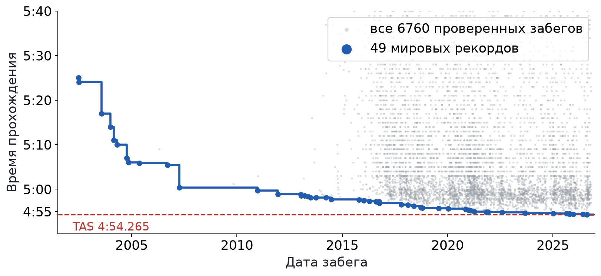
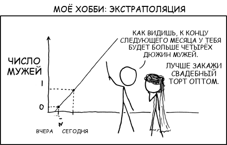
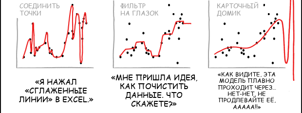
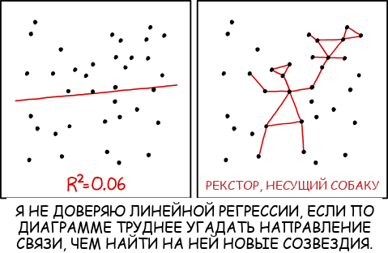
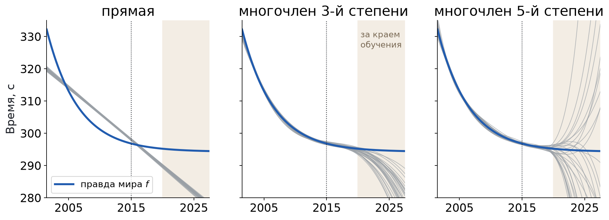
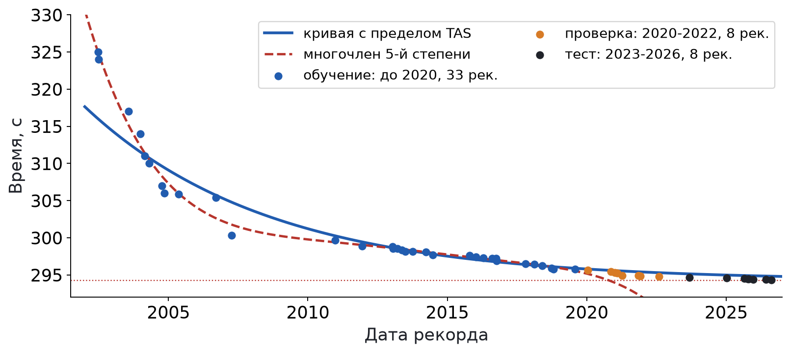

## Пройти Марио за 4:54 {#l4-02}

{height=380 fig-alt="Все проверенные забеги Super Mario Bros. и ступеньки мировых рекордов с 2002 по 2026 год"}

**25.06.2002:** 5:25.000, Aaron Collins. **14.08.2026:** 4:54.332, Niftski.

**Каким будет рекорд 1 января 2030 года?** Запишите своё число.

[Данные: speedrun.com, Super Mario Bros. Any%, версия NTSC, все проверенные забеги на 26.10.2026: 6760 забегов, из них 49 мировых рекордов]{.given}

## Проведите прямую сами {#l4-03}

<svg viewBox="0 0 640 340" role="img" aria-label="49 мировых рекордов и прямая, заданная ползунками"></svg>

<label>время в 2014 году, с <input type="range" name="level" min="290" max="315" step="any" value="310"></label>
<label>наклон, с в год <input type="range" name="slope" min="-5" max="1" step="any" value="-2"></label>
<button type="button" data-best>Лучшая прямая</button>

[Данные: speedrun.com, Super Mario Bros. Any%, версия NTSC, все проверенные забеги на 26.10.2026: 6760 забегов, из них 49 мировых рекордов]{.given}

## Модель обещает ноль секунд {#l4-04}

::: {.columns}
::: {.column width="52%" .meme}
{fig-alt="Комикс xkcd: по двум точкам прямая обещает четыре дюжины мужей к концу месяца"}
[xkcd.com/605, Randall Munroe, CC BY-NC 2.5; перевод наш]{.source}
:::
::: {.column width="46%"}
Лучшая прямая по 49 рекордам:
$$\hat y=301.17-0.8625\,(t-2014).$$

$\hat y=0$ при $t=2014+\dfrac{301.17}{0.8625}\approx2363.$

::: {.fragment}
[Опр.]{.definition} **Экстраполяция**: прогноз модели для значений входа за пределами обучающих данных.

Внутри 2002-2026 прямая ошибается в среднем на несколько секунд. За краем она обещает невозможное.
:::
:::
:::

[Прямая подобрана по всем 49 рекордам методом наименьших квадратов; RMSE 3.87 с]{.given}

## Три вопроса к одной таблице {#l4-05}

Каким будет мировой рекорд 1 января 2030 года?

Побьют ли рекорд до конца 2026 года?

Какие стили прохождения есть среди 6760 забегов? Названий стилей в данных нет.

Этот забег сыгран на консоли или на эмуляторе?

На сколько секунд следующий рекорд будет быстрее нынешнего?

<button type="button" data-guess="Регрессия" aria-pressed="false">Регрессия</button>
<button type="button" data-guess="Классификация" aria-pressed="false">Классификация</button>
<button type="button" data-guess="Кластеризация" aria-pressed="false">Кластеризация</button>

<button type="button" data-next hidden>Следующий вопрос</button>

[Опр.]{.definition} **Регрессия**: прогноз числа. **Классификация**: выбор категории. **Кластеризация**: поиск групп похожих объектов без готовых ответов.

## Ошибка первая: модель слишком простая {#l4-06}

Прямая не умеет **замедляться**: наклон один на все годы.

| Рекорды | Число рекордов | Наклон прямой | Ноль секунд |
|---|:-:|:-:|:-:|
| 2002-2007 | 11 | −4.85 с/год | 2068 год |
| все, 2002-2026 | 49 | −0.86 с/год | 2363 год |
| 2020-2026 | 16 | −0.16 с/год | 3817 год |

::: {.fragment}
[Опр.]{.definition} **Смещение** (bias): систематическая ошибка модели, которая остаётся при любом объёме данных, потому что форма модели не может описать закономерность.

Сколько рекордов ни добавляй, прямая не изогнётся. Это называют **недообучением**.
:::

[Каждая прямая подобрана МНК только по рекордам своего периода; год нуля: $t=t_0-\hat y(t_0)/b$]{.given}

## Ошибка вторая: другие годы, другая модель {#l4-07}

<svg viewBox="0 0 640 340" role="img" aria-label="Прямая по рекордам выбранных лет"></svg>

<label>с года <input type="range" name="from" min="2002" max="2024" step="1" value="2002"></label>
<label>по год <input type="range" name="to" min="2004" max="2026" step="1" value="2007"></label>

[Опр.]{.definition} **Дисперсия модели**: насколько меняется прогноз, если обучить ту же модель на другом наборе данных той же природы.

[Прямая подобрана МНК по рекордам выбранных лет; ноль секунд: год, где прямая пересекает 0]{.given}

## Ошибка третья: модель слишком гибкая {#l4-08}

<svg viewBox="0 0 640 340" role="img" aria-label="Многочлен выбранной степени по рекордам до 2020 года"></svg>

<label>степень многочлена: <b class="degree-value">1</b> <input type="range" name="degree" min="1" max="10" step="1" value="1"></label>

 обучение, до 2020 ·  после 2020, модель их не видела

[Опр.]{.definition} **Переобучение**: модель подстраивается под случайные особенности обучающих данных; ошибка на них маленькая, на новых большая.

[Многочлены степени 1-10 подобраны МНК по 33 рекордам до 01.01.2020; RMSE считается по этим же 33 рекордам]{.given}

## «Не продлевайте её!» {#l4-09}

{height=300 fig-alt="Нижний ряд комикса xkcd о подгонке кривых: соединить точки, фильтр на глазок, карточный домик"}
[xkcd.com/2048, Randall Munroe, CC BY-NC 2.5; перевод наш; нижний ряд из 12 картинок]{.source}

| Степень | 1 | 3 | 10 |
|---|:-:|:-:|:-:|
| RMSE на обучении, с | 3.76 | 1.25 | 0.61 |
| Прогноз на 14.08.2026, с (факт 294.332) | 283.8 | 246.1 | −45 944 |

[Многочлены подобраны МНК по 33 рекордам до 01.01.2020; RMSE по этим же 33 рекордам]{.given}

## Где предел: TAS {#l4-10}

[Опр.]{.definition} **TAS** (tool-assisted speedrun): прохождение, собранное программой покадрово, без ошибок реакции.

| | Время | Кто, когда |
|---|:-:|---|
| TAS по правилам замера живых забегов | **4:54.265** | Maru371, 29.04.2019 |
| Мировой рекорд человека | **4:54.332** | Niftski, 14.08.2026 |

Разница: $294.332-294.265=0.067$ с.

Кадр NES (NTSC): $1/60.0988\approx0.01664$ с, поэтому $0.067/0.01664\approx4$ **кадра**.

[Время TAS: Википедия, Super Mario Bros. speedrunning; частота кадров NES NTSC 60.0988 Гц]{.given}

## Шум: то, что не предсказать {#l4-11}

::: {.columns}
::: {.column width="55%"}
$$y=f(t)+\varepsilon$$

- $f(t)$: **закономерность**, каким рекорд «должен быть» к дате $t$.
- $\varepsilon$: **шум**, случайная часть: удачная попытка, день, кадр.
- $\mathbb E\,\varepsilon=0$, $\operatorname{Var}\varepsilon=\sigma^2$.

[Опр.]{.definition} **Неустранимая ошибка**: $\sigma^2$, часть ошибки, которую не убирает никакая модель.
:::
::: {.column width="43%" .meme}
{fig-alt="Комикс xkcd: прямая с R² 0.06 и созвездие по тем же точкам"}
[xkcd.com/1725, Randall Munroe, CC BY-NC 2.5; перевод наш]{.source}
:::
:::

## Мир, где мы знаем правду {#l4-12}

**Учебный мир.** Задаём правду сами:
$$f(t)=294.265+34.30\,e^{-0.200\,(t-2002)},\qquad y=f(t)+\varepsilon,\ \ \sigma=1\text{ с}.$$

{height=290 fig-alt="30 альтернативных историй: прямые почти одинаковы, многочлены 3-й и 5-й степени расходятся после 2020 года"}

[Синтетика: 2000 историй по 33 датам настоящих рекордов до 2020; $A=34.30$, $k=0.200$ подобраны по 49 рекордам; $\sigma=1$ с выбрано заранее; на рисунке 30 историй]{.given}

## Ожидаемая ошибка: вывод {#l4-13}

Точка $t$ фиксирована. Случайны: обучающая выборка $D$ (через неё $\hat f$) и шум $\varepsilon$ нового наблюдения. Обозначим $\bar f=\mathbb E_D\hat f(t)$.

$$\mathbb E(y-\hat f)^2=\mathbb E(f+\varepsilon-\hat f)^2=\sigma^2+2\,\mathbb E[\varepsilon(f-\hat f)]+\mathbb E(f-\hat f)^2.$$

::: {.fragment}
$\varepsilon$ не зависит от $D$ и $\mathbb E\varepsilon=0$, поэтому средний член равен 0.

$$\mathbb E(f-\hat f)^2=\mathbb E(f-\bar f+\bar f-\hat f)^2=(f-\bar f)^2+2(f-\bar f)\,\mathbb E(\bar f-\hat f)+\mathbb E(\bar f-\hat f)^2.$$
:::

::: {.fragment}
$\mathbb E(\bar f-\hat f)=\bar f-\bar f=0$. Итог:
$$\boxed{\mathbb E(y-\hat f)^2=\underbrace{(f-\bar f)^2}_{\text{смещение}^2}+\underbrace{\mathbb E(\hat f-\bar f)^2}_{\text{дисперсия}}+\underbrace{\sigma^2}_{\text{шум}}}$$
:::

## Проверяем формулу числами: 2015 год {#l4-14}

Точка внутри обучающих лет: $t=2015$, правда $f=296.816$ с.

| Модель | Смещение² | Дисперсия | Шум $\sigma^2$ | Сумма | Напрямую |
|---|:-:|:-:|:-:|:-:|:-:|
| прямая | 1.525 | 0.040 | 1 | **2.565** | 2.560 |
| степень 2 | 0.441 | 0.053 | 1 | **1.495** | 1.528 |
| степень 3 | 0.010 | 0.079 | 1 | **1.089** | 1.112 |
| степень 5 | 0.000 | 0.104 | 1 | **1.104** | 1.089 |
| степень 10 | 0.000 | 0.281 | 1 | **1.281** | 1.243 |

::: {.fragment}
Со степенью смещение падает, дисперсия растёт. Лучше всего **посередине**. Ниже 1 с² не опустится никто.
:::

[Учебный мир: 2000 историй по 33 датам; смещение² $=(\bar f-f)^2$, дисперсия $=\frac1{2000}\sum(\hat f_h-\bar f)^2$; «напрямую»: $\frac1{2000}\sum(y_h-\hat f_h)^2$ с новым шумом; всё в с²]{.given}

## За краем данных: 2026 год {#l4-15}

Точка за краем обучения: 14.08.2026, правда $f=294.515$ с.

| Модель | Смещение² | Дисперсия | Шум | Сумма |
|---|:-:|:-:|:-:|:-:|
| прямая | 233.6 | 0.25 | 1 | **234.9** |
| степень 3 | 160.4 | 29.0 | 1 | **190.4** |
| степень 5 | 9.7 | 3420 | 1 | **3431** |

::: {.fragment}
Для прямой дисперсию можно посчитать **по формуле**:
$$\operatorname{Var}\hat f(t)=\sigma^2\Big(\frac1n+\frac{(t-\bar t)^2}{\sum(t_i-\bar t)^2}\Big).$$
2015: $1\cdot\big(\tfrac1{33}+\tfrac{3.145^2}{1033.68}\big)=0.040$. 2026: $1\cdot\big(\tfrac1{33}+\tfrac{14.761^2}{1033.68}\big)=0.241$.
:::

[Учебный мир, 2000 историй по 33 датам до 2020; $\bar t=2011.855$, $\sum(t_i-\bar t)^2=1033.68$ по этим датам; по историям: 0.040 и 0.248]{.given}

## Модель, которая знает о пределе {#l4-16}

Знаем предел $L=294.265$ с (TAS, 2019). Предлагаем форму
$$y=L+A\,e^{-k(t-2002)}.$$

::: {.fragment}
Перенесём $L$ и возьмём логарифм:
$$\ln(y-L)=\ln A-k\,(t-2002).$$
Это **прямая** в координатах $(t,\ \ln(y-L))$: обычная линейная регрессия из L2.

По 33 рекордам до 2020: $\ln A=3.151$, $A=23.37$; $k=0.152$ в год.
:::

[$L$: время TAS Maru371 от 29.04.2019, известно до 2020; $A$, $k$ подобраны МНК по 33 рекордам до 01.01.2020]{.given}

## Выбор модели по времени {#l4-17}

::: {.columns}
::: {.column width="60%"}
{fig-alt="Рекорды разделены на обучение до 2020, проверку 2020-2022 и тест 2023-2026; кривая с пределом и многочлен 5-й степени"}
:::
::: {.column width="38%"}
| Модель, обучена до 2020 | RMSE на проверке, с |
|---|:-:|
| среднее | 7.01 |
| прямая | 4.83 |
| степень 3 | 8.09 |
| степень 5 | 2.29 |
| **с пределом TAS** | **0.41** |
:::
:::

::: {.fragment}
Выбрали кривую с пределом. **Один раз** открываем тест 2023-2026: RMSE **0.45 с**.
:::

[Обучение: 33 рекорда до 01.01.2020; проверка: 8 рекордов 2020-2022; тест: 8 рекордов 2023-2026. RMSE $=\sqrt{\frac18\sum(\hat y_i-y_i)^2}$ по 8 рекордам части]{.given}

## Почему нельзя перемешивать годы {#l4-18}

**Случайное разбиение:** рекорд 2024 года в тесте, рекорды 2023 и 2025 в обучении.

Модель видит соседей с обеих сторон. Проверяем **интерполяцию**, а пользоваться будем **экстраполяцией**.

::: {.fragment}
Правило: проверка устроена так же, как будущее использование модели.

Прогноз вперёд → обучаемся на прошлом, проверяем на более позднем.
:::

## Прогноз на 2030 год {#l4-19}

Кривую с пределом переобучаем на **всех 49** рекордах: $A=34.30$, $k=0.200$.

$$\hat y(2030)=294.265+34.30\,e^{-0.1999\cdot28}=294.265+34.30\cdot0.00371=294.392\text{ с}=\mathbf{4{:}54.392}.$$

::: {.fragment}
Нынешний рекорд **4:54.332** уже быстрее. Модель предсказывает **типичный** уровень, а рекорд это удачная попытка ниже типичного.

А что записали вы?
:::

[$A$, $k$: МНК для $\ln(y-294.265)$ по 49 рекордам 2002-2026; $t=2030.0$, $t-2002=28$]{.given}

## Что будет на семинарах {#l4-20}

::: {.columns}
::: {.column width="50%"}
**S9. Метрика и редкий класс.**

Детектор нейротекста точен на 98%. Вас обвинили в списывании. Насколько вероятно, что вы правда списали?
:::
::: {.column width="50%"}
**S10. Деревья и ансамбли.**

Рэп, рок или поп? По числам Spotify угадаем жанр российских песен. Сначала дерево строит сам зал, потом против него лес.
:::
:::

## Материалы для продолжения {#l4-21}

- [speedrun.com: Super Mario Bros., таблица рекордов](https://www.speedrun.com/smb1)
- [Википедия: Super Mario Bros. speedrunning](https://en.wikipedia.org/wiki/Super_Mario_Bros._speedrunning)
- [Учебник Яндекса по ML: разложение ошибки на смещение и разброс](https://education.yandex.ru/handbook/ml/article/bias-variance-decomposition)
- [Google ML Crash Course: переобучение](https://developers.google.com/machine-learning/crash-course/overfitting)
- [Bismuth: Why 4:54 is the perfect speedrun (видео, поиск на YouTube)](https://www.youtube.com/results?search_query=Bismuth+Why+4%3A54+is+the+perfect+speedrun)
