## Вы против сети {#s7-02}

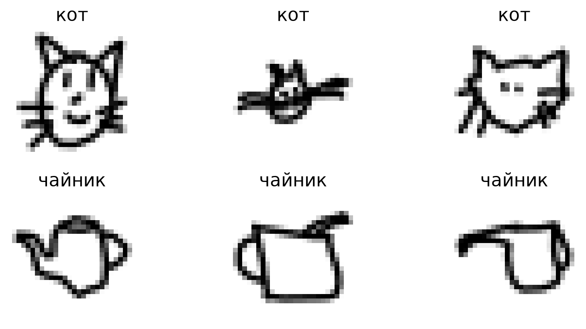{height=330 fig-alt="Настоящие рисунки игроков: коты и чайники"}

**Ставки сделаны:** сеть обучится на 800 рисунках и увидит 400 новых.
**Сколько из 400 она перепутает?** Запишите своё число.

[Пустой notebook](../starter/notebooks/S07-live-coding.ipynb) · [Полный пример](../starter/notebooks/solutions/S07-complete.ipynb)

[Рисунки: Google Quick, Draw!, CC BY 4.0.]{.source}

## Зачем здесь PyTorch {#s7-03}

У нашей сети будет **12 577** весов и смещений. Производную по каждому на каждом шаге посчитает PyTorch.

[Опр.]{.definition} **Тензор**: число или таблица чисел в PyTorch. Один вес, таблица пикселей, столбец меток.

**NumPy** читает массивы, **matplotlib** рисует, **PyTorch** хранит параметры и считает производные.

[Настройки выбраны заранее: один поток процессора, генератор случайных чисел 7]{.given}

## Что лежит в файле {#s7-04}

Данные: **600 котов + 600 чайников = 1200 рисунков**.

Каждый рисунок: **28 × 28 = 784 пикселя**, записанных в одну строку.

Метки: **0 = кот, 1 = чайник**. Метка означает слово, которое загадали игроку.

[Происхождение, отбор и лицензия](../starter/data/QUICKDRAW-README.md)

## Штраф за ответ {#s7-05}

Сеть выдаёт число $z$. Сигмоида делает из него оценку чайника:
$$p=\sigma(z)=\frac1{1+e^{-z}},\qquad\text{оценка кота}=1-p.$$

[Опр.]{.definition} **Бинарная логарифмическая потеря (BCE)**: штраф за оценку при известной метке:
$$\ell=-\bigl(y\ln p+(1-y)\ln(1-p)\bigr).$$

| Пример: на рисунке чайник, $y=1$ | $p=0.5$ | $p=0.9$ | $p=0.1$ |
|---|---:|---:|---:|
| Штраф $-\ln p$ | 0.693 | 0.105 | 2.303 |

`BCEWithLogitsLoss` получает сразу **z**: сигмоиду и штраф она считает внутри.

## Сверяем PyTorch с доской {#s7-06}

Ручной пример лекции: $x=1$, начальный вес $w=1$, выход $z=h-1$, метка $y=1$ (чайник).
$$h=\operatorname{ReLU}(1\cdot1)=1,\quad z=0,\quad p=0.5,\quad L=-\ln0.5\approx0.693147.$$
$$\frac{\partial L}{\partial w}=\underbrace{(0.5-1)}_{p-y}\cdot1\cdot1\cdot1=-0.5.$$

`requires_grad=True`: запоминать операции · `backward()`: посчитать производную · `w.grad`: прочитать её.

**Вес после `backward()` ещё не меняется.**

## Нейрон, который не слышит {#s7-07}

Тот же пример, но **начальный вес $w=-1$**:
$$a=(-1)\cdot1=-1,\quad h=\max(0,-1)=0,\quad z=0-1=-1.$$
$$p=\frac1{1+e^{1}}\approx0.268941,\qquad L=-\ln p\approx1.313262.$$
$$\frac{\partial L}{\partial w}=(p-1)\cdot1\cdot\underbrace{0}_{\text{ReLU на минусе}}\cdot1=0.$$

**Потеря большая. Почему вес не получает никакой подсказки?**

## Прячем экзамен {#s7-08}

Пиксели от 0 до 255 делим на **255**: получаем числа от 0 до 1.

Треть рисунков прячем до самого конца:
$$\underbrace{1200\cdot\tfrac13=400}_{\text{test: экзамен}},\qquad\underbrace{1200-400=800}_{\text{train: учебник}}.$$

`stratify=labels`: в каждой части коты и чайники поровну, **400 + 400** в train, **200 + 200** в test.

Тензоры: входы **800 × 784**, метки **800 × 1** (`reshape(-1, 1)`: один столбец).

[Доля 1/3 и число 7 для перемешивания выбраны заранее]{.given}

## Сеть 784 → 16 → 1 {#s7-09}

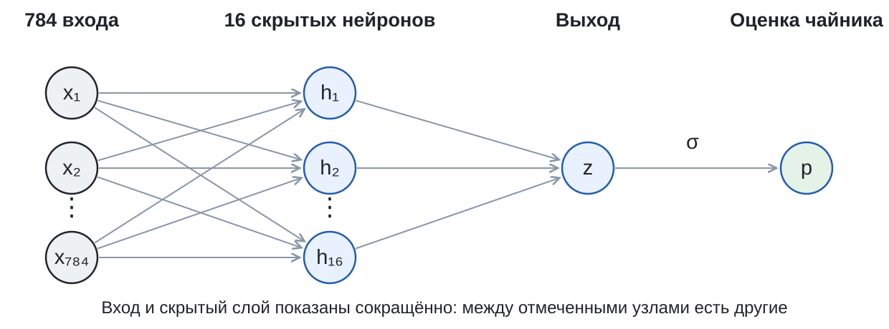{height=230 fig-alt="784 пикселя, 16 скрытых ReLU-нейронов, выход z, сигмоида для оценки p"}

$$\underbrace{784\cdot16+16}_{\text{скрытый слой}}+\underbrace{16\cdot1+1}_{\text{выход}}=12\,577\text{ параметров}.$$

**SGD** делает шаг градиентного спуска для каждого: $\theta_{\text{нов}}=\theta-0.5\cdot\dfrac{\partial L}{\partial\theta}$.

[16 нейронов и шаг 0.5 выбраны заранее · генератор 7]{.given}

## Двести шагов обучения {#s7-10}

| Команда | Что делает |
|---|---|
| `zero_grad()` | стирает производные прошлого шага |
| `model(X_train)` | считает $z$ для всех 800 train-рисунков |
| `loss_function(...)` | средний штраф: сумма 800 штрафов / 800 |
| `backward()` | производные по всем 12 577 параметрам |
| `step()` | сдвигает каждый параметр |

Заодно при тех же весах считаем средний штраф на **400 test**: **только смотрим**, в `backward` он не идёт.

[Опыт S7: 800 train + 400 test · 200 шагов SGD, шаг 0.5 · генератор 7]{.given}

## Ножницы {#s7-11}

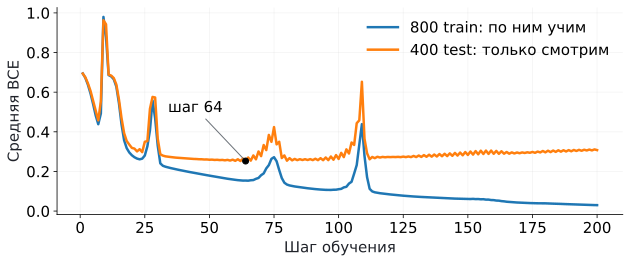{height=300 fig-alt="Средняя BCE на 800 train-рисунках падает почти до нуля, на 400 test-рисунках сначала падает, после шага 64 растёт"}

[Опр.]{.definition} **Переобучение**: модель всё лучше отвечает на обучающих примерах и всё хуже на новых.

Наименьший штраф на test: **0.2525 на шаге 64**. К шагу 200 он вырос до **0.3076**, а на train упал до **0.0299**.

[Опыт S7: 800 train + 400 test · 200 шагов SGD, шаг 0.5 · генератор 7]{.given}

## Экзамен на новых рисунках {#s7-12}

Ответ «чайник», если $p\ge0.5$. Так как $\sigma(0)=0.5$ и сигмоида растёт, в коде проверяем $z\ge0$.

::: {.fragment}
| Часть | Рисунков | Ошибок | Доля ошибок |
|---|---:|---:|---:|
| train (учебник) | 800 | 0 | 0 / 800 = 0% |
| test (экзамен) | 400 | **45** | 45 / 400 = **11.25%** |
:::

**Чья ставка ближе к 45?**

[Опыт S7: 800 train + 400 test · 200 шагов SGD, шаг 0.5 · генератор 7 · веса после всех 200 шагов]{.given}

## Ошибки сети: угадайте сами {#s7-13}

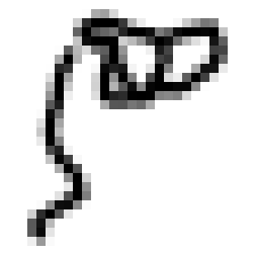
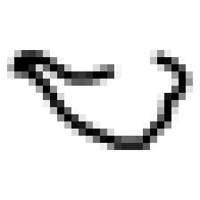
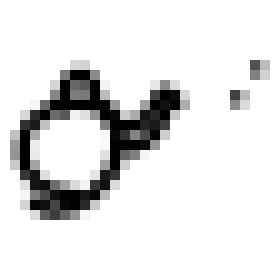
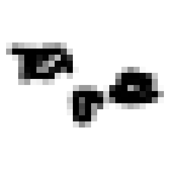
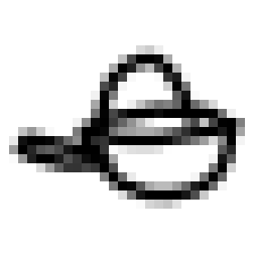
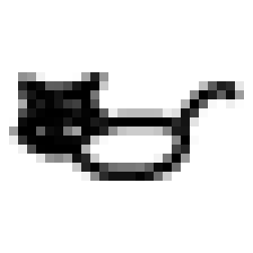

Рисунок 1 из 6

Сеть здесь ошиблась. А вы?

<button type="button" data-guess="Кот" aria-pressed="false">Кот</button>
<button type="button" data-guess="Чайник" aria-pressed="false">Чайник</button>

Выберите вариант, чтобы открыть метку набора.

<button type="button" data-next hidden>Следующий рисунок</button>

[Первые 6 из 45 ошибок по порядку 400 test-рисунков. Google Quick, Draw!, CC BY 4.0.]{.source}

## А была ли нужна ReLU? {#s7-14}

**Сравним с моделью без скрытого слоя:** `Linear(784, 1)`, сразу пиксели → $z$, $784+1=785$ параметров.

::: {.fragment}
| Модель | Параметров | Ошибок train / 800 | Ошибок test / 400 |
|---|---:|---:|---:|
| Без скрытого слоя | 785 | 29 | **47** |
| 16 нейронов с ReLU | 12 577 | 0 | **45** |
:::

**Что купили 11 792 дополнительных параметра?**

[Обе модели: генератор 7 · 200 шагов SGD, шаг 0.5 · те же 800 train и 400 test]{.given}

## Рентген сети {#s7-15}

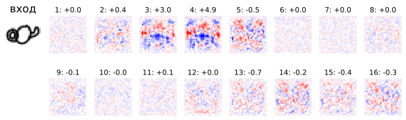{height=250 fig-alt="Первый test-рисунок и веса 16 нейронов в виде картинок 28 на 28 с подписанными голосами"}

Веса нейрона $i$: картинка 28 × 28. **Красный**: штрих повышает сумму, **синий**: понижает.
**Голос** $=$ выходной вес $\times\ \operatorname{ReLU}(\text{сумма})$. $z=$ сумма 16 голосов $+$ смещение. Плюс тянет к чайнику, минус к коту.

[Первый рисунок test · веса после 200 шагов на 800 train]{.given}

## Кролик в списке из кота и чайника {#s7-16}

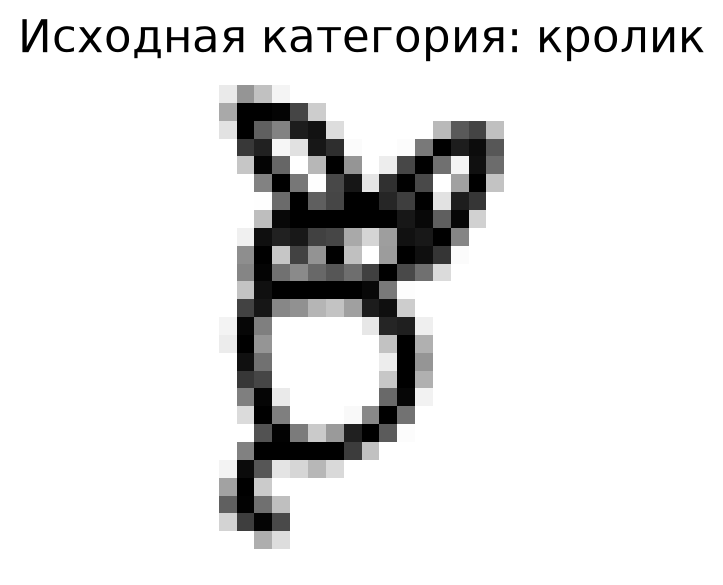{height=300 fig-alt="Настоящий рисунок категории rabbit, которая отсутствует среди двух обученных классов"}

У сети только **2 ответа: кот и чайник**. Кролика нет ни в train, ни в test.

**Что она скажет?** Голосуем: кот или чайник.

::: {.fragment}
Ответ сети: $p=\sigma(z)\approx$ **0.777**, «чайник».
:::

[Веса после 200 шагов на 800 train · Google Quick, Draw!, CC BY 4.0]{.source}

## Нарисуйте сами {#s7-17}

<canvas class="xray-pad" width="240" height="240" aria-label="Поле для рисунка мышью"></canvas>

<button type="button" data-clear>Стереть</button> <button type="button" data-sample="0">кот из test</button> <button type="button" data-sample="1">чайник из test</button> <button type="button" data-sample="2">ошибка сети</button> <button type="button" data-sample="3">кролик</button>

Вход
<canvas class="xray-input" width="28" height="28" aria-label="Что получает сеть: 28 на 28"></canvas>
28 × 28

16 скрытых нейронов: голос + за чайник, − за кота

<canvas width="28" height="28" aria-label="Веса нейрона 1"></canvas>

<canvas width="28" height="28" aria-label="Веса нейрона 2"></canvas>

<canvas width="28" height="28" aria-label="Веса нейрона 3"></canvas>

<canvas width="28" height="28" aria-label="Веса нейрона 4"></canvas>

<canvas width="28" height="28" aria-label="Веса нейрона 5"></canvas>

<canvas width="28" height="28" aria-label="Веса нейрона 6"></canvas>

<canvas width="28" height="28" aria-label="Веса нейрона 7"></canvas>

<canvas width="28" height="28" aria-label="Веса нейрона 8"></canvas>

<canvas width="28" height="28" aria-label="Веса нейрона 9"></canvas>

<canvas width="28" height="28" aria-label="Веса нейрона 10"></canvas>

<canvas width="28" height="28" aria-label="Веса нейрона 11"></canvas>

<canvas width="28" height="28" aria-label="Веса нейрона 12"></canvas>

<canvas width="28" height="28" aria-label="Веса нейрона 13"></canvas>

<canvas width="28" height="28" aria-label="Веса нейрона 14"></canvas>

<canvas width="28" height="28" aria-label="Веса нейрона 15"></canvas>

<canvas width="28" height="28" aria-label="Веса нейрона 16"></canvas>

Выход

[Та же сеть: 784 → 16 ReLU → 1 после 200 шагов на 800 train. Рисунок вписывается в 28 × 28 и делится на максимум, как в данных]{.given}
