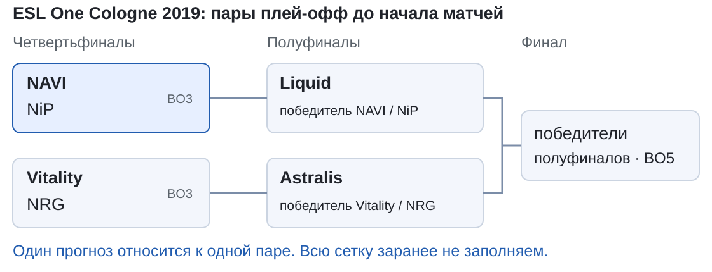
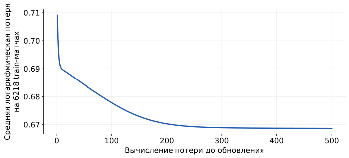
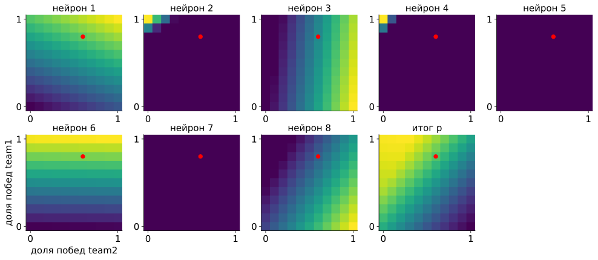
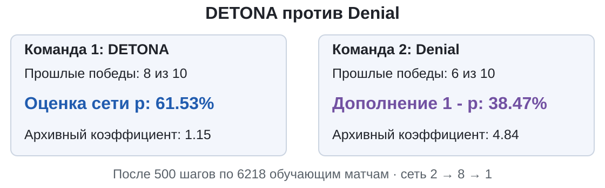
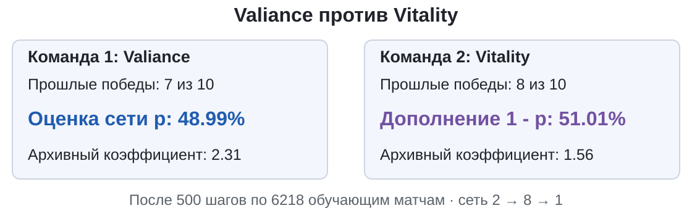
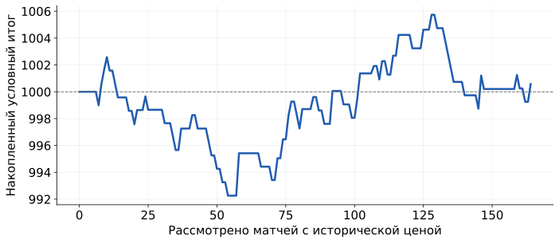

## Кто победит? {#s8-02}

**25 апреля 2019 года, сутки до матча BO3.**

| | **DETONA** | **Denial** |
|---|:-:|:-:|
| Побед в последних 10 матчах | 8 | 6 |
| Коэффициент букмекера | 1.15 | 4.84 |

Коэффициент: во сколько раз вырастет ставка при победе.

**Кто победит? Поставили бы на DETONA?** Ответ в конце пары.

[Данные из архива матчей CS:GO; коэффициенты записаны 25.04.2019 03:58:51, старт 26.04.2019 04:00:00]{.source}

## Одна строка, один матч {#s8-03}

{height=230 fig-alt="Пары плей-офф ESL One Cologne 2019 до матчей"}

Одна строка CSV: один матч **BO3** (серия до 2 выигранных карт). Всего **7843** матча 2016-2019 годов.

$p$: **оценка победы первой команды в строке** (`team1`). Для второй $1-p$. Метка $y=1$: победила первая.

[Notebook](../starter/notebooks/S08-live-coding.ipynb) · [Полный пример](../starter/notebooks/solutions/S08-complete.ipynb) · [Сетка: NAVI](https://navi.gg/en/publications/4115-esl-one-cologne-2019) · [Подготовка данных](../starter/data/CSGO-README.md){.source}

## Что сеть знает до матча {#s8-04}

**Вход сети: две доли побед** в последних 10 матчах каждой команды:
$$x_1=8/10=0.8,\qquad x_2=6/10=0.6.$$

Матчи в истории закончились **более чем за сутки** до записи коэффициента.

**Можно добавить число убийств в этом матче?**

::: {.fragment}
Нельзя: до матча его ещё нет. Иначе сеть «предскажет» прошлое.
:::

[Сутки запаса выбраны заранее: в источнике нет времени окончания серии]{.given}

## Учим на прошлом, проверяем на будущем {#s8-05}

| Часть | Зачем | Матчи | Строк |
|---|---|---|---:|
| `train` | менять веса | 2016-2018 | 6218 |
| `validation` | промежуточная проверка | начало 2019, до 25 апреля | 952 |
| `test` | финальный экзамен | 25 апреля - 8 июля 2019 | 673 |

$$6218+952+673=7843.$$

**Почему не перемешать матчи случайно, как рисунки?**

## Сеть 2 → 8 → 1 и её соперник {#s8-06}

$$[x_1,x_2]\ \longrightarrow\ 8\text{ ReLU-нейронов}\ \longrightarrow\ z\ \longrightarrow\ p=\frac1{1+e^{-z}}.$$

$$2\cdot8+8+8\cdot1+1=33\text{ параметра}.$$

**Соперник без всякой сети:** в train первая команда выиграла **3360 из 6218** матчей. Всем матчам говорим
$$p=3360/6218\approx0.5404.$$

Сеть должна это обыграть, иначе она не нужна.

[Сеть 2 → 8 ReLU → 1 · 500 шагов SGD, шаг 0.5, генератор 8 · обучение на 6218 матчах 2016-2018]{.given}

## Обучение {#s8-07}

{height=270 fig-alt="Логарифмическая потеря сети на 6218 обучающих матчах за 500 шагов"}

Штраф тот же, что для котов: $\ell=-\bigl(y\ln p+(1-y)\ln(1-p)\bigr)$, среднее по **6218** train-матчам.

Шаг 1: **0.709**. Шаг 500: **0.669**. Для сравнения: ответ «50 на 50» даёт $-\ln0.5=0.693$.

[Сеть 2 → 8 ReLU → 1 · 500 шагов SGD, шаг 0.5, генератор 8 · обучение на 6218 матчах 2016-2018]{.given}

## Что выучила сеть {#s8-08}

{height=330 fig-alt="Восемь карт скрытых нейронов и итоговая карта p по всем 121 сочетанию долей побед"}

Все $11\times11=121$ сочетание долей. По вертикали team1, по горизонтали team2. **Красная точка: DETONA - Denial**, $p=0.6153$.

Нейроны **5 и 7 молчат на всех входах**. Итог $p$ от **0.18** (0 и 10 из 10) до **0.77** (10 и 0 из 10).

[Сеть 2 → 8 ReLU → 1 · 500 шагов SGD, шаг 0.5, генератор 8 · обучение на 6218 матчах 2016-2018]{.given}

## Угадать мало {#s8-09}

**Два условных матча:** в первом победила первая команда ($y=1$), во втором вторая ($y=0$).

| Прогноз для первой команды | матч 1 | матч 2 | угадано |
|---|:-:|:-:|:-:|
| Осторожный | 0.6 | 0.6 | 1 из 2 |
| Самоуверенный | 0.9 | 0.9 | 1 из 2 |

[Опр.]{.definition} **Brier Score**: средний квадрат ошибки вероятности, $\dfrac1n\sum(p_i-y_i)^2$. Меньше лучше.

::: {.fragment}
Осторожный: $\frac{(0.6-1)^2+(0.6-0)^2}{2}=\frac{0.16+0.36}{2}=0.26$. Самоуверенный: $\frac{0.01+0.81}{2}=0.41$.

**Validation, 952 матча:** сеть $217.77/952\approx$ **0.2287**, постоянная 0.5404: $232.29/952\approx$ **0.2440**.
:::

## Как работает коэффициент {#s8-10}

**Условный пример:** ставка **1**, коэффициент $k=1.5$, мы оцениваем шанс победы в $p=0.6$.

| Исход | Вернут | Чистый результат |
|---|---:|---:|
| Победа | $1\cdot1.5=1.5$ | $+0.5$ |
| Поражение | 0 | $-1$ |

**В среднем на одну ставку:**
$$0.6\cdot0.5+0.4\cdot(-1)=-0.1=p\cdot k-1.$$

**Почему 60% побед не спасают?**

## Правило ставки {#s8-11}

**Правило записано до экзамена и больше не меняется:**

1. Рассматриваем только ставку **1 на первую команду** в записи.
2. Берём её $p$ от сети и её коэффициент $k$.
3. **Ставим, если $p\cdot k-1>0.05$.** Иначе пропускаем.

Нет коэффициента за **24-48 часов** до старта: матч пропускаем.

[Начальный виртуальный счёт 1000, ставка 1 и порог 0.05 выбраны заранее]{.given}

## Экзамен на последних матчах {#s8-12}

**Test: 673 матча** с 25 апреля по 8 июля 2019 года. Первые 500 шагов на train уже сделаны, правило записано.

::: {.fragment}
| Прогнозист | Угадано победителей | Brier |
|---|---:|---:|
| Всегда первая команда / постоянная 0.5404 | 360 / 673 = 53.5% | $167.45/673\approx0.2488$ |
| **Сеть** | **402 / 673 = 59.7%** | $161.41/673\approx$ **0.2398** |
:::

[Сеть 2 → 8 ReLU → 1 · 500 шагов SGD, шаг 0.5, генератор 8 · обучение на 6218 матчах 2016-2018]{.given}

## Два матча: сеть решает {#s8-13}

::: {.columns}
::: {.column width="50%"}
{height=170 fig-alt="DETONA: оценка сети 61.53%, коэффициент 1.15. Denial: 38.47%, коэффициент 4.84"}

$0.6153\cdot1.15-1\approx-0.29$

**Сеть за DETONA, но ставку пропускает.**
:::
::: {.column width="50%"}
{height=170 fig-alt="Valiance: оценка сети 48.99%, коэффициент 2.31. Vitality: 51.01%, коэффициент 1.56"}

$0.4899\cdot2.31-1\approx+0.13>0.05$

**Сеть за Vitality, но ставит на Valiance.**
:::
:::

Позиции **0** и **6** среди **164** test-матчей с коэффициентами.

[Сеть 2 → 8 ReLU → 1 · 500 шагов SGD, шаг 0.5, генератор 8 · обучение на 6218 матчах 2016-2018]{.given}

## Открываем исходы {#s8-14}

{height=230 fig-alt="Накопленный условный итог после 164 матчей, от 1000 до 1000.58"}

Valiance проиграла: $2.31\cdot0-1=-1$.

Всего **63** ставки из **164** матчей: **26** выигрышей (возврат **63.58**) и **37** проигрышей.
$$\text{итог}=63.58-26-37=+0.58\quad\Rightarrow\quad1000.58.$$

**Одной ставки хватит, чтобы стереть этот плюс.**

## Букмекер как прогнозист {#s8-15}

Коэффициент тоже прогноз. DETONA - Denial: $k_1=1.15$, $k_2=4.84$.
$$\frac1{1.15}\approx0.870,\quad\frac1{4.84}\approx0.207,\quad\text{сумма }1.076>1.$$

Лишние **7.6%**: заработок букмекера. Нормируем:
$$q_1=\frac{0.870}{1.076}\approx0.808.$$

Сеть давала DETONA **0.615**, букмекер **0.808**.

[Нормировка деления на сумму выбрана как простой способ; истинную вероятность она не гарантирует]{.given}

## Табло: сеть против букмекера {#s8-16}

**Те же 164 test-матча с коэффициентами:**

| | Всегда первая | **Сеть** | **Букмекер** |
|---|:-:|:-:|:-:|
| Угадано победителей | 86 / 164 | 94 / 164 | 94 / 164 |
| Brier (меньше лучше) | | $40.63/164\approx0.248$ | $38.08/164\approx$ **0.232** |
| Ставки по правилу | | $+0.58$ на 63 ставках | |

::: {.fragment}
**DETONA - Denial: победила DETONA.** Ставка 1 вернула бы всего $+0.15$.
:::
